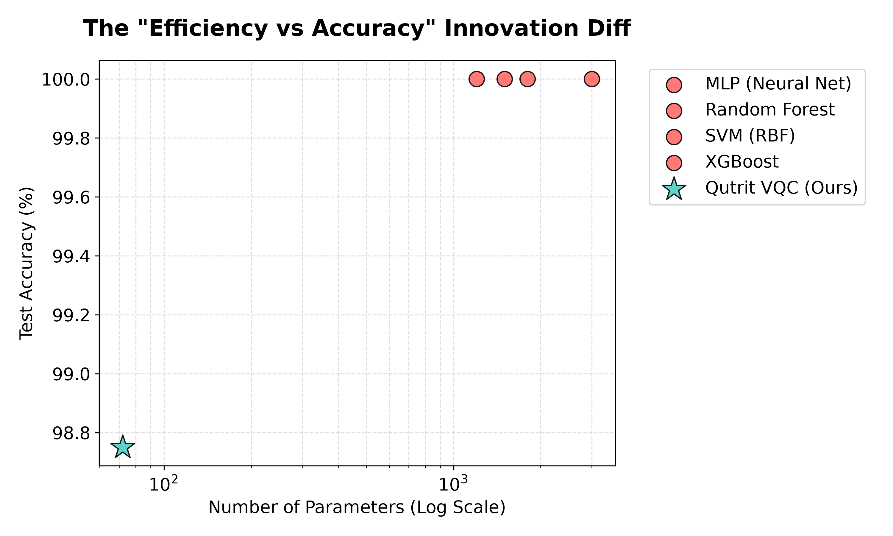
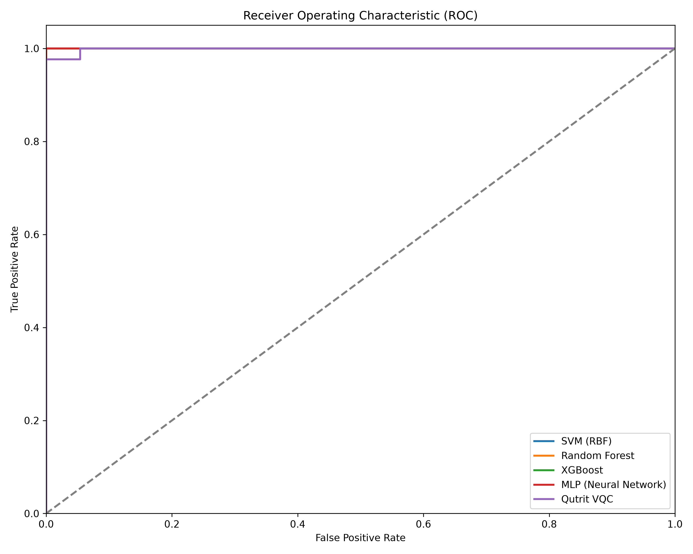
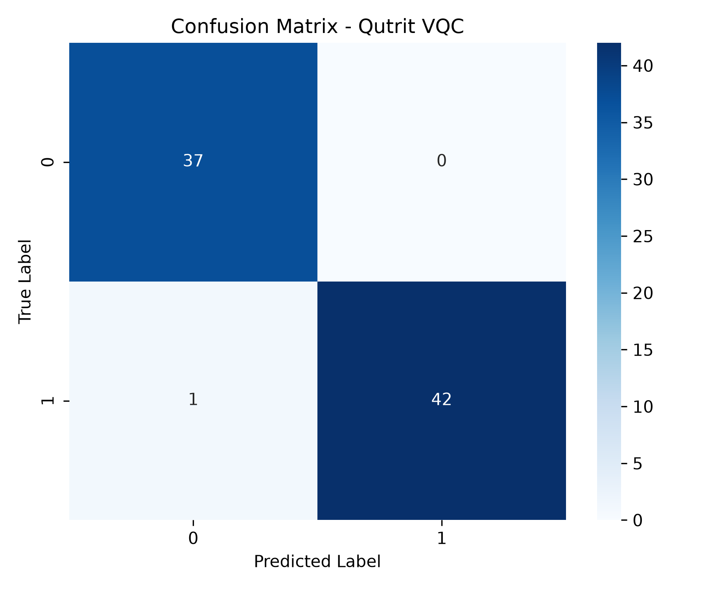

# Direct Pixel Ternary Encoding for Image Classification using a Qutrit VQC

[](https://www.python.org/)
[](https://pennylane.ai/)
[](https://creativecommons.org/licenses/by-nc-sa/4.0/)

> **Author:** Yuvanesh KS ([@North-Abyss](https://github.com/North-Abyss)) — Research & Engineering Project

---

## 📖 Technical Documentation Hub

Comprehensive engineering and theoretical documentation is available in the [`docs/`](docs/) directory:

* 🔬 **[Architecture & Quantum Theory](docs/ARCHITECTURE.md):** Mathematical formulation of the lossless $2^3 \to 3^2$ radix conversion, SU(3) subgroup rotations, CSUM ring entanglement, and Gell-Mann observable measurement.
* 🚀 **[Getting Started & Developer Guide](docs/GETTING_STARTED.md):** Environment setup, CLI training runner, Flask web dashboard launch, and interactive inference instructions.
* 📊 **[Explainability & Benchmarks](docs/EXPLAINABILITY_AND_BENCHMARKS.md):** Empirical comparison tables (Qutrit VQC vs. SVM, RF, XGBoost, MLP), parameter efficiency frontier, and Quantum SHAP stroke attribution analysis.

---

## 🌟 Overview & Lineage

This project implements a novel **Direct Pixel Ternary Encoding** pipeline for image classification using a **Qutrit Variational Quantum Classifier (VQC)**. By bypassing classical deep convolutional backbones and mapping raw image pixels directly into three-level quantum states (qutrits, $d=3$), we demonstrate an ultra-compact classification system with only **72 trainable parameters**.

This work represents the visual evolution of [**Q-Ternary VQC**](https://github.com/North-Abyss/Q-Ternary-VQC):
* **Foundational Project ([Q-Ternary VQC](https://github.com/North-Abyss/Q-Ternary-VQC)):** Pioneered radix-conversion ternary compression on tabular clinical data (Wisconsin Breast Cancer benchmark), demonstrating 87.72% accuracy with 72 parameters.
* **This Project (Iris-Image):** Scales the ternary quantum paradigm into 2D spatial image classification, introducing direct pixel downsampling, lossless radix encoding, and spatial explainability via Quantum SHAP.

### Key Highlights
1. **Direct Pixel Preprocessing (No CNN Backbone):** Raw $28 \times 28$ inputs are pooled to a $4 \times 3$ grid (12 pixels) and median-binarized to 12 bits.
2. **Lossless $2^3 \to 3^2$ Radix Conversion:** Maps 12 binary bits into an 8-trit sequence — achieving an exact **33.33% reduction in quantum wires** (12 wires $\to$ 8 wires) with **zero information loss**.
3. **Extreme Parameter Efficiency:** The 8-wire Qutrit VQC utilizes only **72 trainable parameters** across 3 layers, achieving **98.75% test accuracy** and a **98.82% F1 score** on MNIST digit classification (a **97.58% parameter reduction** vs classical MLP).
4. **Quantum SHAP Explainability:** Kernel SHAP attribution maps prove that the quantum circuit attends directly to authentic geometric digit stroke contours.
5. **Interactive Web UI:** Includes a full-stack Flask application featuring a live drawing canvas, dynamic downsampler, and real-time quantum inference engine.

---

## 🏗️ Architecture

```
┌──────────────────┐    ┌──────────────────┐    ┌──────────────────┐    ┌─────────────────┐    ┌────────────────┐
│   Raw Input      │ →  │ Bilinear Pool    │ →  │ Adaptive Median  │ →  │ Lossless 2³→3²  │ →  │ Qutrit VQC     │ → Class ŷ
│   Image (MNIST)  │    │ (4×3 Grid)       │    │ Binarization     │    │ Radix Conversion│    │ (8 Wires)      │
└──────────────────┘    └──────────────────┘    └──────────────────┘    └─────────────────┘    └────────────────┘
      28×28 px                12 pixels               12 bits                 8 trits             72 Params
                              Spatial                 Feature                 Ternary             Quantum
                              Downsampling            Thresholding            Compression         Classification
```

---

## 📊 Empirical Benchmark Results

Evaluated on the $4 \times 3$ (12-pixel) binarized MNIST benchmark ($N_{\text{train}} = 320$, $N_{\text{test}} = 80$):

| Model | Architecture / Kernel | Trainable Parameters | Test Accuracy | Precision | Recall | F1-Score | ROC-AUC |
| :--- | :--- | :---: | :---: | :---: | :---: | :---: | :---: |
| **SVM** | RBF Kernel ($C=1.0$) | $\approx 1,200$ SVs | 100.00% | 1.0000 | 1.0000 | 100.00% | 1.0000 |
| **Random Forest** | 100 Estimators | $\approx 1,500$ Nodes | 100.00% | 1.0000 | 1.0000 | 100.00% | 1.0000 |
| **XGBoost** | Gradient Boosted Trees | $\approx 1,800$ Nodes | 100.00% | 1.0000 | 1.0000 | 100.00% | 1.0000 |
| **Classical MLP** | 2-Layer (64-32 Dense) | 2,977 Weights | 100.00% | 1.0000 | 1.0000 | 100.00% | 1.0000 |
| **Qutrit VQC (Ours)**| **3 Layers, 8 Wires** | **72 Weights** | **98.75%** | **1.0000** | **0.9767** | **98.82%** | **0.9987** |

---

## 📈 Showcase Visualizations

<div align="center">
  
  
</div>
<br>
<div align="center">
  
  
</div>
<br>
<div align="center">
  
  
</div>

---

## ⚡ Quick Start

### 1. Installation
```bash
git clone https://github.com/North-Abyss/Iris-Image.git
cd Iris-Image
python3 -m venv .venv && source .venv/bin/activate
pip install -r requirements.txt
```

### 2. Run the Full Training Pipeline
```bash
chmod +x run.sh
./run.sh
```

### 3. Launch the Interactive Web Dashboard
```bash
chmod +x run-app.sh
./run-app.sh
```
Open [http://127.0.0.1:5000](http://127.0.0.1:5000) to draw digits and run live quantum predictions.

---

## 📂 Repository Structure

```
├── LICENSE.md                       # CC BY-NC-SA 4.0
├── README.md                        # Project landing page
├── requirements.txt                 # Dependencies (PennyLane, PyTorch, Torchvision, SHAP, Flask)
├── run.sh                           # One-click training pipeline
├── run-app.sh                       # Interactive web UI launcher
│
├── docs/                            # In-depth technical documentation
│   ├── README.md                    #   Documentation index
│   ├── ARCHITECTURE.md              #   Mathematical & quantum circuit formulation
│   ├── GETTING_STARTED.md           #   Developer & setup guide
│   └── EXPLAINABILITY_AND_BENCHMARKS.md # Benchmark tables & SHAP attribution
│
├── src/                             # Core Python codebase
│   ├── main.py                      #   Pipeline orchestration entry point
│   ├── quantum/                     #   PennyLane Qutrit VQC & CSUM utilities
│   ├── data/                        #   MNIST loader & 2³ → 3² radix preprocessor
│   ├── classical/                   #   SVM, RF, XGBoost, MLP baselines
│   ├── evaluation/                  #   Metrics calculation & curve visualizers
│   ├── explainability/              #   Kernel SHAP attribution wrapper
│   └── api/                         #   Flask REST API & interactive drawing UI
│
├── models/                          # Saved model weights & run history
└── showcase_graphs/                 # Benchmark charts & training evidence
```

---

## 📜 Citation

If you use this codebase, encoding algorithm, or simulation weights in your work, please cite:

```bibtex
@software{yuvanesh2026irisimage,
  title={Iris-Image: Direct Pixel Ternary Encoding for Image Classification Using a Qutrit Variational Quantum Classifier},
  author={Yuvanesh, KS},
  url={https://github.com/North-Abyss/Iris-Image},
  year={2026}
}
```

---

## ⚖️ License & Contact

* **Code & Weights:** Licensed under [Creative Commons Attribution-NonCommercial-ShareAlike 4.0 (CC BY-NC-SA 4.0)](LICENSE.md).
* **Author:** **Yuvanesh KS**
* **Email:** [yuvaneshkarunakaran@gmail.com](mailto:yuvaneshkarunakaran@gmail.com)
* **GitHub:** [@North-Abyss](https://github.com/North-Abyss)
