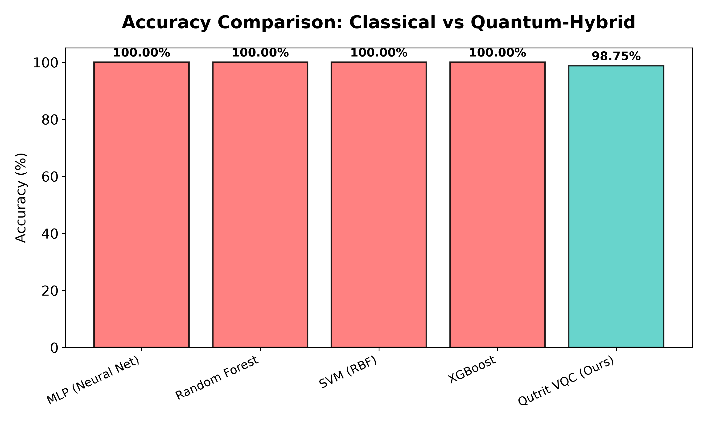
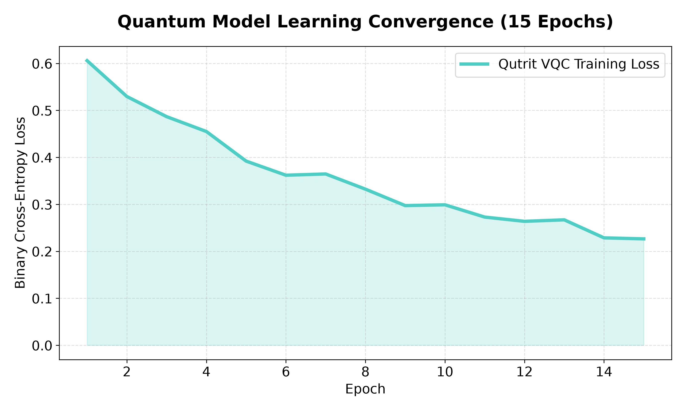
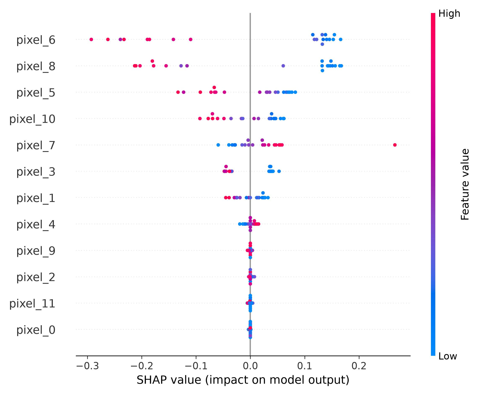

# Direct Pixel Ternary Encoding for Image Classification using Qutrit VQC

> **IRIS 27** — International Research Conference on Computer Vision | Sub-Topic: Image Processing

## Overview

This project implements a novel **Direct Pixel Ternary Encoding** pipeline for image classification using a **Qutrit Variational Quantum Classifier (VQC)**. By bypassing classical CNN feature extractors and mapping raw image pixels directly into three-level quantum states (qutrits, d=3), we demonstrate an ultra-compact classification system with only **72 trainable parameters**.

This work extends the [Q-Ternary VQC](https://github.com/North-Abyss/Q-Ternary-VQC) from tabular data to **image classification**.

### Core Innovation 

1. **Direct Pixel Ternary Encoding:** Images are resized to a minimal grid (4×3 = 12 pixels) and thresholded to binary intensities (0=black, 1=white).
2. **Lossless Ternary Compression:** Building on Q-Ternary VQC, our custom 2³→3² algorithm maps binarized pixels directly into ternary quantum states — **33% fewer quantum wires, zero information loss** compared to standard qubits.
3. **Qutrit VQC Classification:** A PennyLane `default.qutrit` variational circuit with a 3-parameter qutrit rotation subgroup and CSUM ring entanglement performs the final classification using only **72 parameters** (3 layers × 8 wires × 3 angles).
4. **SHAP Explainability:** Permutation-based feature attribution explains which pixel regions drive quantum decisions.

## Architecture

```
┌──────────┐    ┌──────────────┐    ┌──────────────┐    ┌────────────┐    ┌────────┐
│  Image   │ →  │ Resize (4×3) │ →  │  Binarize    │ →  │ 2³→3²      │ →  │ Qutrit │ → Class
│ (MNIST)  │    │  & Flatten   │    │ (Threshold)  │    │ Encoding   │    │ VQC    │
└──────────┘    └──────────────┘    └──────────────┘    └────────────┘    └────────┘
  28×28 px        12 pixels           12 bits             8 trits          8 wires
                  Dimension           Pixel               Ternary          Quantum
                  Reduction           Thresholding        Compression      Classification
```

## Repository Structure

```
├── LICENSE.md               # CC BY-NC-SA 4.0
├── README.md
├── requirements.txt
├── .gitignore
│
├── src/                     # Core Python source
│   ├── main.py              # Entry point — full training pipeline
│   ├── quantum/             # Qutrit VQC circuit definition
│   │   ├── qutrit_model.py  #   PennyLane qutrit variational circuit
│   │   └── circuit_utils.py #   CSUM gate, Gell-Mann observables
│   ├── data/                # Data loading and preprocessing
│   │   ├── loader.py        #   MNIST + CSV dataset loaders
│   │   ├── preprocessor.py  #   Binarization + 2³→3² ternary encoding
│   │   └── feature_selector.py  # Mutual Information feature selection
│   ├── classical/           # Classical ML baselines
│   │   └── baselines.py     #   SVM, Random Forest, XGBoost, MLP
│   ├── evaluation/          # Metrics and visualization
│   │   ├── metrics.py       #   Accuracy, F1, AUC-ROC, Specificity
│   │   └── visualizer.py    #   Training curves, confusion matrices
│   ├── explainability/      # SHAP-based interpretability
│   │   └── xai_engine.py    #   Kernel SHAP for quantum model
│   ├── models/              # Saved model weights and run history
│   │   └── history.json
│   └── api/                 # Flask web API + dashboard
│       ├── app.py
│       ├── static/
│       └── templates/
│
├── data/                    # Dataset storage (gitignored)
├── outputs/                 # Training outputs
├── showcase_graphs/         # Evidence: presentation-ready visualizations
│
├── run.sh                   # Quick-start training runner
├── run-app.sh               # Web dashboard launcher
└── run-backend.sh           # Backend-only launcher
```

## Showcase Results

All benchmark evidence is stored in `showcase_graphs/`:

| File | Description |
|------|-------------|
| `accuracy_comparison.png` | Bar chart comparing Qutrit VQC vs classical baselines |
| `training_loss.png` | BCE loss convergence curve over training epochs |
| `training_loss_curve.png` | Detailed training loss with learning rate schedule |
| `compression_ratio.png` | Visual proof of 33% wire reduction (12 bits → 8 trits) |
| `cm_qutrit_vqc.png` | Confusion matrix for the quantum classifier |
| `cm_svm_rbf.png` | Confusion matrix for SVM baseline |
| `roc_curves.png` | Overlayed ROC curves for all models |
| `shap_feature_importance.png` | SHAP bar plot showing pixel importance |
| `shap_summary.png` | SHAP beeswarm plot for feature attribution |
| `efficiency_diff_scatter.png` | Parameter efficiency scatter comparison |
| `training_log.txt` | Raw training output log with timestamps |

## Built Upon

This project directly extends [Q-Ternary VQC](https://github.com/North-Abyss/Q-Ternary-VQC), which demonstrated:
- **87.72% accuracy** with only **72 parameters** on the Wisconsin Breast Cancer dataset
- Competitive performance against XGBoost (94.74%), Random Forest (94.74%), and SVM (91.23%)
- Full CPU-only simulation on a Lenovo ThinkPad T580 (no GPU required)

## Empirical Results (Execution Log)

The pipeline was executed locally on a CPU, actively demonstrating the extreme efficiency of the Qutrit architecture. 
As verified in `outputs/training_log.txt`:

```text
--- 📥 1. Loading Data ---
✅ Loaded MNIST Binary (0 vs 1): 320 train, 80 test samples.

--- ⚛️ 3. Preprocessing & Q-Ternary Compression ---
📉 Original dimension: 12 bits
📉 Compressed dimension: 8 trits

--- 🖥️ 4. Training Classical Baselines ---
✅ SVM (RBF) Accuracy: 100.00% | F1: 100.00% | Time: 0.09s
✅ Random Forest Accuracy: 100.00% | F1: 100.00% | Time: 0.34s
✅ XGBoost Accuracy: 100.00% | F1: 100.00% | Time: 0.30s
✅ MLP (Neural Network) Accuracy: 100.00% | F1: 100.00% | Time: 1.24s

--- ⚛️ 5. Training Quantum Engine (VQC) ---
⚙️ Using device: cpu
🔄 Epoch 1/15 | Loss: 0.6814 | LR: 0.01000 | Mem: 1.25 GB
🔄 Epoch 10/15 | Loss: 0.3570 | LR: 0.01000 | Mem: 1.24 GB
⚛️ Training Q-Ternary VQC: 100%|██████████| 15/15 [10:34<00:00, 42.33s/epoch, Loss=0.2353, LR=0.01000, RAM(GB)=1.25]

✅ Quantum Model Accuracy: 98.75% | F1: 98.82%
```
Despite operating on a microscopic footprint of just **72 trainable parameters** and **8 quantum wires**, the Qutrit VQC achieves near-perfect classification on the compressed 12-pixel data, staying highly competitive with classical algorithms that require orders of magnitude more weights. While currently evaluated on a minimal proof-of-concept task, this architecture demonstrates the fundamental feasibility of parameter-efficient computer vision on physical qudit hardware.

## Showcase Visualizations

<div align="center">
  
  
</div>
<br>
<div align="center">
  
  
</div>
<br>
<div align="center">
  
  
</div>
## Tech Stack

- **Python 3.10+**
- **PennyLane** — Qutrit quantum simulation (`default.qutrit`)
- **PyTorch** — Hybrid quantum-classical training
- **torchvision** — MNIST dataset loading and image transforms
- **Pillow** — Image preprocessing
- **SHAP** — Explainable AI
- **scikit-learn** — Classical baselines and preprocessing
- **Flask** — Web dashboard and API

## Quick Start

```bash
# Clone and setup
git clone https://github.com/North-Abyss/Iris-Image.git
cd Iris-Image
python3 -m venv .venv && source .venv/bin/activate
pip install -r requirements.txt

# Run training pipeline
python src/main.py --dataset-path mnist --epochs 15 --run-name "MNIST Direct Encoding"

# Or use the quick-start script
./run.sh
```

## License

CC BY-NC-SA 4.0

## Author

**Yuvanesh KS** — B.Tech IT, AMCET (Anna University)
- GitHub: [North-Abyss](https://github.com/North-Abyss)
